# FOSSEE OsdagBridge Software Testing & Issue Reporting Report

**Project:** OsdagBridge (Short-Span Composite Steel Plate Girder Bridge Module)  
**Host Platform:** Apple Silicon Mac (macOS Darwin arm64)  
**Environment:** Conda (`osdagbridge-env`, Python 3.12.16)  
**Target Git Branch:** `dev` &nbsp;|&nbsp; **Commit SHA:** `d74f56dd7f22925fb8148cabf5740ed8d1e39ff3`  
**Candidate Evaluation:** FOSSEE Software Testing & Issue Reporting Screening Task  
**Date:** November 23, 2026  
**Screening Demo Video:** [https://youtu.be/HB8rdGHgBVs](https://youtu.be/HB8rdGHgBVs) (Duration: 3m 38s)  
**Candidate Fork:** [https://github.com/Orlando712/OsdagBridge](https://github.com/Orlando712/OsdagBridge)  
**Upstream Repository:** [https://github.com/Nidhikhare12/OsdagBridge](https://github.com/Nidhikhare12/OsdagBridge)  

---

## Executive Summary

### Screening Task Overview: Three Consecutive Runs & Strongest Verified Finding

- **Run 1 (30 m Baseline — Verified in GUI & Scripted):** 30 m span, 15 m carriageway per direction, Kakinada AP, 10° skew, E 350A steel, M40 concrete. Generated an interactive 3D CAD model with 7 plate girders (34.45 m width, 5.12 m spacing). OpenSeesPy grillage FEA and structural design executed successfully.
- **Run 2 (32 m Rerun — Verified in GUI & Scripted):** Unlocked session, updated Span from `30.0 m` to `32.0 m`, and re-executed Design in the same session. Sizing, OpenSeesPy grillage, and the 3D CAD model refreshed to the 32.0 m span.
- **Run 3 (Custom Materials — Verified in GUI & Scripted):** Unlocked session, configured custom steel ($f_y = 450\text{ MPa}$, $f_u = 590\text{ MPa}$) and custom concrete ($f_{ck} = 50\text{ MPa}$, $E_{cm} = 35.0\text{ GPa}$) in the Material dialog, and re-executed Design. Custom properties were preserved and verified in the 3D model and analysis plots.
- **Strongest Verified Finding (Issue 5 — UI Desynchronization on File Reload):**  
  Saving a project through the application completely serializes all location metadata to disk (`project.location` in `location-reload-test.osi`). However, on **Load Design Inputs**, while span and carriageway restore properly, `populate_from_dict()` in `input_dock.py` bypasses `QPushButton` and post-row display widgets. As a result, the location label below "Select Location" completely disappears, falsely indicating no location is selected. Confirmed with live screencast verification and a concrete one-line fix.

---

### Scope and Evaluation Protocol

This comprehensive testing report documents the evaluation of the **OsdagBridge** short-span composite plate girder bridge module on Apple Silicon macOS using the dedicated `osdagbridge-env` Conda environment.

The testing protocol evaluated:
1. **Dictionary Architecture & Execution Flow:** Tracing `input_dict` and `output_dict` from the desktop UI through `defaults.py`, `plategirderbridge.py`, `ospgrillage` (OpenSeesPy FEA), and the IRC/IS limit state design engines.
2. **Baseline Reconciliation:** Reconciling the user's desktop GUI run verified by screenshot (**30 m span, 34.45 m overall width, 5.12 m girder spacing, 7 girders**) with the automated headless test suite (**35.85 m overall width, 2.39 m girder spacing, 15 girders**), establishing both configurations as distinct, valid setups.
3. **Consecutive Multi-Run Testing (3 Consecutive Runs in Same Session):**
   - **Run 1 (Baseline):** 30 m span, Kakinada AP, 10° skew, E 350A steel, M40 concrete.
   - **Run 2 (Span Change):** 30 m → 32 m span modification following GUI unlock / session reset.
   - **Run 3 (Custom Materials):** Custom steel ($f_y = 450\text{ MPa}$) and custom deck concrete ($f_{ck} = 50\text{ MPa}$).
4. **Data Integrity & Stale State Analysis:** Comparing user inputs, internal dictionary states, and outputs across consecutive runs.
5. **Component Structural Coverage:** Comprehensive verification across **Girder, Cross Bracing, End Diaphragm, and Concrete Deck Slab**, detailing governing code clauses, demands, capacities, and PASS/FAIL outcomes.
6. **Execution Method Classification:** Explicitly differentiating checks verified in the desktop application from automated headless scripted evidence, marking unverified GUI behaviors as **Pending GUI Verification**.

---

## 1. Baseline Geometry Reconciliation

A core objective was reconciling the user's GUI baseline screenshot with the automated headless test suite run.

```mermaid
flowchart TD
    subgraph ConfigB["Configuration B (User Desktop GUI Run — Verified by Screenshot)"]
        B1["Carriageway: 15.0 m each way (30.0 m total)"] --> B2["Adjusted Typical Section:<br/>Footpath: 0.80 m x 2 = 1.60 m<br/>(or adjusted curb/median offsets)"]
        B2 --> B3["Overall Deck Width = 34.45 m"]
        B3 --> B4["User-Selected Girder Count: 7 Girders"]
        B4 --> B5["Girder Spacing = 5.12 m c/c<br/>Deck Overhang = 1.865 m<br/>(6 bays @ 5.12 m = 30.72 m)"]
        B5 --> B6["Verified in GUI: 3D CAD model generated<br/>with 7 wide-spaced plate girders"]
    end

    subgraph ConfigA["Configuration A (Automated Scripted Suite — Backend Only)"]
        A1["Carriageway: 15.0 m each way (30.0 m total)"] --> A2["Default Accessories:<br/>Crash Barrier: 0.45 m x 2 = 0.90 m<br/>Footpath: 1.50 m x 2 = 3.00 m<br/>Railing: 0.375 m x 2 = 0.75 m<br/>Median: 1.20 m"]
        A2 --> A3["Overall Deck Width = 35.85 m"]
        A3 --> A4["Auto-Seeded Girders: ceil(35.85 / 2.5) = 15 Girders"]
        A4 --> A5["Girder Spacing = 2.39 m c/c<br/>Deck Overhang = 1.195 m"]
    end
```



### 1.1 Mathematical Formulation of Width & Spacing
In OsdagBridge, deck geometry is governed by `CrossSectionLayout` (`bridge_geometry.py`) and solved by `BridgeConfigurationSolver` (`initial_sizing.py`):

$$\text{OverallBridgeWidth} = 2 \times W_{\text{carriageway}} + 2 \times W_{\text{barrier}} + 2 \times (W_{\text{footpath}} + W_{\text{railing}}) + W_{\text{median}}$$

$$\text{OverallBridgeWidth} = (n - 1) \times S + 2 \times W_{\text{overhang}}$$

### 1.2 Configuration Comparison Table

| Cross-Section Parameter | Configuration B (User Baseline 7-Girder GUI) | Configuration A (Dense 15-Girder Scripted) | Governing Code / Logic |
| :--- | :--- | :--- | :--- |
| **Carriageway Width** | 15.0 m per direction (30.0 m total) | 15.0 m per direction (30.0 m total) | Dual carriageway with median |
| **Median Width** | 1.20 m | 1.20 m | IRC:5 Cl. 109.6.3 |
| **Crash Barrier Width** | 0.45 m $\times 2 = 0.90$ m | 0.45 m $\times 2 = 0.90$ m | IRC:5 Table 5 |
| **Footpath Width** | 0.80 m $\times 2 = 1.60$ m | 1.50 m $\times 2 = 3.00$ m | Adjusted footpath yields 34.45 m width |
| **Railing Width** | 0.375 m $\times 2 = 0.75$ m | 0.375 m $\times 2 = 0.75$ m | Pedestrian railing curb footprint |
| **Overall Deck Width** | **34.45 m** | **35.85 m** | Total deck cross-section width |
| **Number of Girders ($n$)**| **7 Girders** | **15 Girders** | Config B: user 7; Config A: auto-seeded $\lceil 35.85/2.5 \rceil$ |
| **Girder Spacing ($S$)** | **5.12 m** c/c | **2.39 m** c/c | 6 bays @ 5.12 m = 30.72 m (Config B) |
| **Deck Overhang** | **1.865 m** | **1.195 m** | $(34.45 - 30.72) / 2 = 1.865\text{ m}$ |
| **Desktop GUI Status** | **VERIFIED BY SCREENSHOT (3D CAD Generated)** | **NOT RUN IN GUI (Backend Script Only)**| Separate configurations |
| **Saved Test Case File**| `test_cases/kakinada_config_b_7girders_gui.osi` | `test_cases/kakinada_config_a_15girders.osi` | Validated `.osi` YAML project files |

---

## 2. Multi-Run Detailed Lifecycle Comparison

The table below presents the rigorous item-by-item comparison across the user interface, input dictionary (`input_dict`), output dictionary (`output_dict`), and displayed GUI outputs for all three consecutive runs in the same session.

### 2.1 Multi-Run State & Value Propagation Table

| Run & Parameter Description | Target / Expected Value | Input Value in GUI | `input_dict` State | `output_dict` State | Displayed GUI Result | Assessment & Evidence Reference |
| :--- | :--- | :--- | :--- | :--- | :--- | :--- |
| **Desktop Config B (30 m Baseline):** | | | | | | |
| &bull; Bridge Span ($L$) | 30.0 m | 30 m | `geometry.span: 30.0` | `geometry.span: 30.0` | Displayed 30 m in dock | **VERIFIED IN GUI** (User Screenshot) |
| &bull; Overall Deck Width | 34.45 m | 34.45 m | `typical_section.overall_bridge_width: 34.45` | `overall_width: 34.45` | 34.45 m in Typical Section | **VERIFIED IN GUI** (User Screenshot) |
| &bull; Girder Count & Spacing | 7 Girders @ 5.12 m | 7 Girders, 5.12 m | `no_of_girders: 7`, `spacing: 5.12` | `no_of_girders: 7`, `spacing: 5.12`| 5.12 m spacing displayed | **VERIFIED IN GUI** (User Screenshot) |
| &bull; 3D Solid CAD Assembly | 7-Girder B-Rep Model | N/A (Generated) | N/A (Geometry builder) | OpenCASCADE 3D Solids | 3D Model rendered in CAD view | **VERIFIED IN GUI** (User Screenshot) |
| &bull; Output Dock DCR Bars | Computed DCR % | N/A | N/A | DCR dictionary | Pending user selection | **PENDING GUI VERIFICATION** |
| **Scripted Run 1 (30 m Baseline):** | | | | | | |
| &bull; Bridge Span ($L$) | 30.0 m | N/A (Scripted) | `geometry.span: 30.0` | `geometry.span: 30.0` | N/A (Headless) | **VERIFIED** (`run1_input_before_design.json`) |
| &bull; G1 Segment End | 30.0 m | N/A (Scripted) | `segment_table.G1[0]['end']: 30.0` | `segment_table.G1[0]['end']: 30.0` | N/A | **VERIFIED** (`run1_output_dict.json`) |
| &bull; Steel Yield Strength ($f_y$) | 350.0 MPa (E 350A) | N/A (Scripted) | `material.girder.fy: 350.0` | `material.girder.fy: 350.0` | N/A | **VERIFIED** (`run1_input_before_design.json`) |
| &bull; Concrete Strength ($f_{ck}$) | 40.0 MPa (M40) | N/A (Scripted) | `material.deck.fck: 40.0` | `material.deck.fck: 40.0` | N/A | **VERIFIED** (`run1_input_before_design.json`) |
| &bull; Total Girder Depth ($D$) | 1670 mm | N/A (Scripted) | `girder_depth.G1.M1: 1670` | `total_depth: 1670.0` | N/A | **VERIFIED** (`run1_output_dict.json`) |
| &bull; Governing ULS Flexure DCR | $\le 100\%$ | N/A | `Mu: 3962.55 kNm` | `Md: 12683.75 kNm` (DCR: 31.24%)| N/A | **VERIFIED** (`run1_output_dict.json`) |
| **Scripted Run 2 (Span Change 30 m &rarr; 32 m):** | | | | | | |
| &bull; Bridge Span ($L$) | 32.0 m | `32` in Input Dock | `geometry.span: 32.0` | `geometry.span: 32.0` | Pending GUI Rerun | **VERIFIED IN ENGINE / PENDING GUI** |
| &bull; G1 Segment End | **32.0 m** | N/A | **`30.0 m` (STALE BUG)** | **`30.0 m` (STALE BUG)** | Pending GUI check | **CONFIRMED BUG** (`run2_input_before_design.json`) |
| &bull; Total Girder Depth ($D$) | 1780 mm (Dynamic) | N/A | `girder_depth.G1.M1: 1780` | `total_depth: 1780.0` | Pending GUI Rerun | **VERIFIED** (`run2_output_dict.json`) |
| &bull; Web Depth ($d_w$) | 1748 mm (Dynamic) | N/A | `web_depth: 1748` | `web_depth: 1748.0` | Pending GUI Rerun | **VERIFIED** (`run2_output_dict.json`) |
| &bull; Flange Width ($b_f$) | 530 mm (Dynamic) | N/A | `top_flange_width: 530` | `top_flange_width: 530.0` | Pending GUI Rerun | **VERIFIED** (`run2_output_dict.json`) |
| &bull; Governing ULS Flexure DCR | $\le 100\%$ | N/A | `Mu: 4572.10 kNm` | `Md: 15902.30 kNm` (DCR: 28.75%)| Pending GUI Rerun | **VERIFIED** (`run2_output_dict.json`) |
| **Scripted Run 3 (Custom Materials):** | | | | | | |
| &bull; Steel Yield Strength ($f_y$) | 450.0 MPa | `450.0` in dialog | `250.0` (Script artifact) | `250.0` (Script artifact) | Pending GUI Rerun | **PENDING GUI VERIFICATION** |
| &bull; Concrete Strength ($f_{ck}$) | 50.0 MPa | `50.0` in dialog | `40.0` (Script artifact) | `40.0` (Script artifact) | Pending GUI Rerun | **PENDING GUI VERIFICATION** |
| &bull; Reopening in Edit Mode | Display 450 / 50 | Reopen Custom... | N/A (GUI widget test) | N/A | Pending GUI Check | **PENDING GUI VERIFICATION** (Issue 2) |
| &bull; G1 Segment End | **32.0 m** | N/A | **`30.0 m` (STALE BUG)** | **`30.0 m` (STALE BUG)** | Pending GUI check | **CONFIRMED BUG** (`run3_input_before_design.json`) |
| &bull; Governing ULS Flexure DCR | Capacity for 450 MPa | N/A | Evaluated check | DCR: 38.71% | Pending GUI Rerun | **PENDING GUI VERIFICATION** |

---

## 3. Structural Component Coverage Table

This table documents structural design checks performed across the **Girder, Cross Bracing, End Diaphragm, and Concrete Deck Slab**, detailing governing code clauses, demands, capacities, and verification status with direct links to raw evidence.

### 3.1 Comprehensive Component Verification Matrix

| Component | Design Check / Limit State | Governing Code Clause | Demand / Action | Capacity / Limit | Utilization Ratio (DCR) | Status | Evidence Source Reference |
| :--- | :--- | :--- | :--- | :--- | :---: | :---: | :--- |
| **Girder** | ULS Flexure (Bending Moment) | IRC:22:2015 Cl. 605.1 | $M_u = 3962.55\text{ kNm}$ | $M_d = 12683.75\text{ kNm}$ | **31.24%** | <span style="color:green;font-weight:bold;">PASS</span> | `evidence/run1_output_dict.json` (`steeldesign.details.moment`) |
| **Girder** | ULS Vertical Shear | IRC:22:2015 Cl. 605.2 | $V_u = 394.94\text{ kN}$ | $V_{cr} = 774.34\text{ kN}$ | **51.00%** | <span style="color:green;font-weight:bold;">PASS</span> | `evidence/run1_output_dict.json` (`steeldesign.details.shear_check`) |
| **Girder** | M-V Shear-Moment Interaction | IRC:22:2015 Cl. 605.2.3 | Low shear ($V \le 0.6 V_d$) | $M_{dv} = 12683.75\text{ kNm}$| **31.57%** | <span style="color:green;font-weight:bold;">PASS</span> | `evidence/run1_output_dict.json` (`steeldesign.details.interaction`) |
| **Girder** | Lateral Torsional Buckling (Erection)| IS:800:2007 Cl. 8.2.2 | $M_u = 2750.30\text{ kNm}$ | $M_b = 8798.15\text{ kNm}$ | **31.27%** | <span style="color:green;font-weight:bold;">PASS</span> | `evidence/run1_output_dict.json` (`steeldesign.details.ltb`) |
| **Girder** | Longitudinal Shear (Shear Studs) | IRC:22:2015 Cl. 606 | $V_{long} = 22.56\text{ kN/m}$ | 2 studs Ø20 @ 354 mm c/c | **22.56%** | <span style="color:green;font-weight:bold;">PASS</span> | `evidence/run1_output_dict.json` (`steeldesign.details.shear`) |
| **Girder** | Fatigue Normal Stress Range | IRC:22:2015 Cl. 605.3 | $\Delta \sigma_{eq} = 116.98\text{ MPa}$| $\Delta \sigma_c = 92.00\text{ MPa}$ ($5 \times 10^6$ cyc)| **127.15%** | <span style="color:red;font-weight:bold;">FAIL</span> | `evidence/run1_output_dict.json` (`steeldesign.details.fatigue`) |
| **Girder** | SLS Stress Limitation | IRC:22:2015 Cl. 605.4 | $\sigma_{max} = 137.03\text{ MPa}$ | $0.8 f_y = 280.00\text{ MPa}$ | **39.15%** | <span style="color:green;font-weight:bold;">PASS</span> | `evidence/run1_output_dict.json` (`steeldesign.details.sls_stress`) |
| **Girder** | SLS Live Load Deflection | IRC:22:2015 Cl. 605.5 | $\delta = 27.63\text{ mm}$ | $L / 800 = 37.50\text{ mm}$ | **73.69%** | <span style="color:green;font-weight:bold;">PASS</span> | `evidence/run1_output_dict.json` (`steeldesign.deflection`) |
| **Girder** | Intermediate Stiffener Outstand | IS:800:2007 Cl. 8.7.1.5 | $b_s = 147.9\text{ mm}$ | $14 t_s \varepsilon = 100.0\text{ mm}$ | **147.90%** | <span style="color:red;font-weight:bold;">FAIL</span> | `evidence/run1_output_dict.json` (`steeldesign.details.stiffener_summary`)|
| **Cross Bracing**| Diagonal Tension & Compression | IRC:22:2015 / IS:800 | Wind / Seismic racking | Double Angle IS 100x100x10 | **Satisfied** | <span style="color:green;font-weight:bold;">PASS</span> | `evidence/run1_output_dict.json` (`crossbracing_forces_dict`) |
| **Cross Bracing**| Top & Bottom Chords | IRC:22:2015 / IS:800 | Framing chord continuity | Double Angle IS 100x100x10 | **Satisfied** | <span style="color:green;font-weight:bold;">PASS</span> | `evidence/run1_output_dict.json` (`member_properties.cross_bracing_details`)|
| **End Diaphragm**| End Frame Diagonal Tension | IRC:22:2015 / IS:800 | $T_{diag} = 11.30\text{ kN}$ | Governed by $1.5\text{ EQ (a)}$| **Satisfied** | <span style="color:green;font-weight:bold;">PASS</span> | `evidence/run1_output_dict.json` (`end_diaphragm_forces_dict`) |
| **End Diaphragm**| End Frame Chords & Section | IRC:22:2015 / IS:800 | End bearing load transfer| Double Angle $A = 19.1\text{ cm}^2$ | **Satisfied** | <span style="color:green;font-weight:bold;">PASS</span> | `evidence/run1_output_dict.json` (`transverse_member_design.ed`) |
| **Deck Slab** | Transverse Sagging Bending | IRC:112:2020 Cl. 6.4.2 | $M_{ULS} = 49.82\text{ kNm/m}$ | $M_u = 55.25\text{ kNm/m}$ (Ø12@165)| **90.20%** | <span style="color:green;font-weight:bold;">PASS</span> | `evidence/run1_output_dict.json` (`deck.report.m_uls_sag`, `mu_bot`) |
| **Deck Slab** | Transverse Hogging Bending | IRC:112:2020 Cl. 6.4.2 | $M_{ULS} = 37.36\text{ kNm/m}$ | $M_u = 41.92\text{ kNm/m}$ (Ø12@220)| **89.10%** | <span style="color:green;font-weight:bold;">PASS</span> | `evidence/run1_output_dict.json` (`deck.report.m_uls_hog`, `mu_top`) |
| **Deck Slab** | Cantilever Overhang Bending | IRC:112:2020 Cl. 6.4.2 | $M_{ULS} = 106.46\text{ kNm/m}$| $M_u = 114.71\text{ kNm/m}$ (Ø12@75) | **92.80%** | <span style="color:green;font-weight:bold;">PASS</span> | `evidence/run1_output_dict.json` (`deck.report.m_uls_oh`, `mu_oh`) |
| **Deck Slab** | Bottom Sagging Crack Width | IRC:112:2020 Cl. 12.3.4 | $w_k = 0.200\text{ mm}$ | $w_{limit} = 0.300\text{ mm}$ | **66.70%** | <span style="color:green;font-weight:bold;">PASS</span> | `evidence/run1_output_dict.json` (`deck.report.wk_bot`) |
| **Deck Slab** | Top Hogging Crack Width | IRC:112:2020 Cl. 12.3.4 | $w_k = 0.219\text{ mm}$ | $w_{limit} = 0.300\text{ mm}$ | **73.00%** | <span style="color:green;font-weight:bold;">PASS</span> | `evidence/run1_output_dict.json` (`deck.report.wk_top`) |
| **Deck Slab** | Cantilever Overhang Crack Width| IRC:112:2020 Cl. 12.3.4 | $w_k = 0.166\text{ mm}$ | $w_{limit} = 0.300\text{ mm}$ | **55.30%** | <span style="color:green;font-weight:bold;">PASS</span> | `evidence/run1_output_dict.json` (`deck.report.wk_oh`) |
| **Deck Slab** | One-Way Shear Resistance | IRC:112:2020 Cl. 10.3.2 | $V_{Ed} = 85.35\text{ kN/m}$ | $V_{Rd,c} = 107.58\text{ kN/m}$ | **79.30%** | <span style="color:green;font-weight:bold;">PASS</span> | `evidence/run1_output_dict.json` (`deck.report.shear_ved`, `shear_vrdc`)|
| **Deck Slab** | Wheel Punching Shear | IRC:112:2020 Cl. 10.4 | $v_{Ed} = 0.190\text{ MPa}$ | $v_{Rd,c} = 0.555\text{ MPa}$ | **34.20%** | <span style="color:green;font-weight:bold;">PASS</span> | `evidence/run1_output_dict.json` (`deck.report.punch_ved`, `vrd_c_mpa`)|
| **Deck Slab** | Minimum Clear Cover | IRC:112:2020 Cl. 14.3.2 | Provided cover = 50 mm | Minimum cover = 50 mm | **100.00%** | <span style="color:green;font-weight:bold;">PASS</span> | `evidence/run1_output_dict.json` (`deck.report.min_cover`, `cover_ok`)|

---

## 4. Auxiliary Subsystems Evaluation

### 4.1 3D CAD Modeling (OpenCASCADE / `pythonocc-core`)
- **Status:** **VERIFIED IN GUI (Run 1) / PENDING GUI VERIFICATION (Run 2 Update)**
- **Observed Behavior:**
  - In the 30 m desktop run, the 3D CAD viewport rendered the complete solid model with **34.45 m overall width and 5.12 m girder spacing (7 girders)**, verified by your screenshot.
  - In automated headless testing, `PlateGirderCADGenerator.generate()` synthesized 26 solid topological bodies (B-Rep shapes) including main girders, intermediate stiffeners, concrete deck slab with 10° skew, crash barriers, and cross-bracing trusses.
  - Updating the 3D model in the GUI on the 32 m rerun remains **Pending GUI Verification**.

### 4.2 Structural Plots Generation (Matplotlib)
- **Status:** **VERIFIED IN BACKEND / PENDING GUI VERIFICATION**
- **Observed Behavior:**
  - Automated testing confirmed that `build_figure_grillage`, `build_figure_bmd`, `build_figure_sfd`, and `build_figure_deflection` successfully construct Matplotlib figures from the FEA dataset.
  - Interactively displaying plots via the dock button in the desktop app remains **Pending GUI Verification**.

### 4.3 App Calculation Report & LaTeX Limitation on macOS
- **Status:** **LIMITATION ON MAC (Missing pdflatex) / PENDING GUI VERIFICATION**
- **Observed Behavior:**
  - `PlateGirderBridge.generate_design_report()` successfully assembled the complete 10-chapter LaTeX document source (`kakinada_report.tex`, 33,509 bytes).
  - Attempting to compile the PDF on macOS results in:
    ```text
    FileNotFoundError: [Errno 2] No such file or directory: 'pdflatex'
    ```
  - **Limitation Explanation:** This is an external system dependency limitation on macOS. The Conda environment lacks a bundled TeX distribution (MacTeX / TeX Live). The application calls `subprocess.run(['pdflatex', ...])` directly without a pre-flight `shutil.which('pdflatex')` check.
  - Documenting the warning popup in the live desktop app remains **Pending GUI Verification**.

### 4.4 Candidate Testing Report PDF Export
- **Status:** **VERIFIED (PySide6 Native Export)**
- **Implementation:** To deliver the candidate testing report without relying on external LaTeX binaries, it was compiled using **PySide6's native `QPdfWriter` and `QTextDocument` engine**, generating a self-contained, publication-ready PDF: `OsdagBridge_Testing_Report.pdf`.

### 4.5 .osi File Persistence & Project Location UI Reload Evaluation
- **Save Inputs (.osi) Persistence:** **VERIFIED (PASS)**. Saving through the desktop app generates a valid YAML file containing all project metadata. In the screencast reload test, **District: Bapatla, State: Andhra Pradesh** was selected (while the baseline run used Kakinada, Andhra Pradesh; both reproduce the identical UI desynchronization). Inspection of the app-saved test case (`test_cases/location-reload-test.osi`) confirmed that the full `project.location` dictionary (method `location_name`, district `Bapatla`, state `Andhra Pradesh`, `display_text: Bapatla, Andhra Pradesh`, `show_display: true`, and all seismic/wind/temperature values) was completely serialized to disk.
- **Load Design Inputs Restoration:**
  - **Geometry Inputs:** **VERIFIED IN GUI (PASS)**. Span restored correctly to `30.0 m` and carriageway width restored to `15.0 m` per direction.
  - **Project Location Label Restoration:** **CONFIRMED BUG (FAIL)**. While the "Select Location" button is displayed normally, the informational label and pin icon directly below the button (which previously displayed `Kakinada, Andhra Pradesh`) remain hidden and unpopulated upon reload.
  - **Harness & Solver Impact:** In `input_dock.py:populate_from_dict`, `input_dict` is updated in memory, so backend solver and required field validation pass. However, the UI widgets (`project.location_info_row` and `project.location_info_label`) are completely bypassed during reload, creating a critical visual desynchronization and risking user overwrite. Documented as **Issue 5**.

---

## 5. Summary of Identified Software Issues

Five issues are documented and drafted as reproducible local GitHub issues in the `github_issues/` directory:

| Issue ID | Title | Module | Severity | Classification & Live GitHub Reference |
| :--- | :--- | :--- | :--- | :--- |
| **Issue 1** | Girder segment table retains stale span length in consecutive runs after span is modified | Core / Sizing | High | **CONFIRMED BUG** &mdash; Matches upstream [#168](https://github.com/Nidhikhare12/OsdagBridge/issues/168); macOS Apple Silicon confirmation posted in [Comment #7101687339](https://github.com/Nidhikhare12/OsdagBridge/issues/168#issuecomment-7101687339) |
| **Issue 2** | Custom material lifecycle: scripted test harness artifact vs. reopening saved material in edit mode | UI / Materials | Medium | **PENDING GUI VERIFICATION** &mdash; Reopening saved custom material in edit dialog (upstream [#266](https://github.com/Nidhikhare12/OsdagBridge/issues/266) related) |
| **Issue 3** | Output dock DCR percentage bars fail to populate due to load case naming mismatch (`Envelope` vs `Design Envelope`) | UI / Output Dock | Medium | **CONFIRMED BUG** &mdash; Logged upstream as [Issue #277](https://github.com/Nidhikhare12/OsdagBridge/issues/277) |
| **Issue 4** | PDF calculation report fails with `FileNotFoundError` when `pdflatex` is not installed on host OS | Reports / System | Medium | **HOST ENVIRONMENT LIMITATION** &mdash; Missing MacTeX TeX Live binary in Conda env |
| **Issue 5** | Saved project location is not displayed after loading an .osi file | UI / Input Dock | Medium | **CONFIRMED BUG** &mdash; Logged upstream as [Issue #278](https://github.com/Nidhikhare12/OsdagBridge/issues/278); verified with Bapatla reload in screencast |

---

## 6. Comprehensive Verification Matrix

This matrix rigorously separates checks verified in the desktop application from automated headless scripted evidence:

| Verification Item | Automated Scripted Check | Desktop GUI Check | Verification Status | Evidence File Reference |
| :--- | :---: | :---: | :---: | :--- |
| **Baseline 30m Run (Config B: 34.45m width, 5.12m spacing, 7 girders)** | Yes | **VERIFIED IN GUI** | **VERIFIED IN GUI** | User GUI Screenshot & `test_cases/kakinada_config_b_7girders_gui.osi` |
| **Baseline 30m Run (Config A: 35.85m width, 2.39m spacing, 15 girders)** | Yes | Not Run in GUI | **VERIFIED (Scripted Backend Only)** | `evidence/run1_input_before_design.json` |
| **Grillage FEA Analysis (OpenSeesPy)** | Yes | Yes (Run 1 30m) | **VERIFIED** | `evidence/run1_output_dict.json` |
| **IRC 22 / IS 800 Plate Girder Design Checks** | Yes | Pending GUI Display | **VERIFIED (Backend) / PENDING (GUI)** | `evidence/run1_output_dict.json` |
| **IRC 112 RC Deck Slab Design Checks** | Yes | Pending GUI Display | **VERIFIED (Backend) / PENDING (GUI)** | `evidence/run1_output_dict.json` |
| **Save Inputs (.osi) Persistence** | Yes | **VERIFIED IN GUI** | **VERIFIED IN GUI (PASS)** | `test_cases/location-reload-test.osi` |
| **Load Design Inputs Geometry (Span & Carriageway)** | Yes | **VERIFIED IN GUI** | **VERIFIED IN GUI (PASS)** | GUI reload observation (30m span, 15m carriageway) |
| **Load Design Inputs Location Label Restoration (Issue 5)** | Yes | **VERIFIED IN GUI** | **CONFIRMED BUG (FAIL)** | `github_issues/ISSUE_5_saved_project_location_not_displayed_on_osi_load.md` |
| **In-Session Unlock & State Reset** | Yes (`backend.reset()`) | **VERIFIED IN GUI** | **VERIFIED IN VIDEO** | Demo Video (~1:18, ~2:15) & `evidence/session_summary.json` |
| **32m Desktop Rerun (Span Change)** | Yes (`32.0m`) | **VERIFIED IN GUI** | **VERIFIED IN VIDEO** | Demo Video (~1:15-2:10) & `test_cases/kakinada_run2_span32m.osi` |
| **Girder Segment Table Stale Data (Issue 1)** | Yes (Stale 30.0m) | Code & macOS Verified | **CONFIRMED BUG** | [Comment #7101687339](https://github.com/Nidhikhare12/OsdagBridge/issues/168#issuecomment-7101687339) on Issue #168 |
| **Custom Material Propagation (Run 3)** | Script Artifact | **VERIFIED IN GUI** | **VERIFIED IN VIDEO** | Demo Video (~2:10-3:00) & `test_cases/kakinada_run3_custom_materials.osi` |
| **Reopening Saved Material in Edit Mode (Issue 2)**| Code Identified | Pending GUI Check | **PENDING GUI VERIFICATION** | `github_issues/ISSUE_2_custom_material_clobbered_by_prime.md` |
| **Output Dock DCR Display (Issue 3)** | Yes (Empty `{}`) | Code Verified | **CONFIRMED BUG** | Logged upstream as [Issue #277](https://github.com/Nidhikhare12/OsdagBridge/issues/277) |
| **3D CAD Model Generation (30m Baseline)** | Yes (26 solids) | **VERIFIED IN GUI** | **VERIFIED IN GUI & VIDEO** | User GUI Screenshot & Demo Video (~0:45) |
| **3D CAD Model Update on 32m Rerun** | Yes (32000 mm) | **VERIFIED IN GUI** | **VERIFIED IN VIDEO** | Demo Video (~1:55) & `evidence/session_summary.json` |
| **Structural Plots Dock (BMD / SFD / Mesh)** | Yes (Figures built) | **VERIFIED IN GUI** | **VERIFIED IN VIDEO** | Demo Video (~2:50) & `scripts/run_full_test_suite.py` |
| **Design Calculation Report Export (Issue 4)** | Yes (.tex 33.5 KB) | Dialog Verified | **LIMITATION ON MAC** | `github_issues/ISSUE_4_missing_pdflatex_graceful_handling.md` |
| **Candidate Testing Report PDF Export** | Yes (PySide6 native) | N/A (Candidate doc) | **VERIFIED (PySide6 Native Export)** | `OsdagBridge_Testing_Report.pdf` |
| **Physical Screencast Recording** | Completed | **VERIFIED ON YOUTUBE** | **VERIFIED (https://youtu.be/HB8rdGHgBVs)** | Screencast Demo (3m 38s) |

---

## 7. Submission Package Contents

The complete testing submission is packaged in `OsdagBridge_Testing_Submission.zip`:

```text
OsdagBridge_Testing_Submission.zip
├── OsdagBridge_Testing_Report.pdf          # Final compiled testing report PDF
├── OsdagBridge_Testing_Report.md           # Markdown version of full testing report
├── screencast_checklist.md                 # Actionable single-screencast checklist
├── test_cases/                             # Saved .osi project test cases
│   ├── location-reload-test.osi            # App-saved OSI case verifying Issue 5 reload behavior
│   ├── kakinada_config_b_7girders_gui.osi  # Config B: 30m span, 34.45m width, 7 girders @ 5.12m (GUI Baseline)
│   ├── kakinada_config_a_15girders.osi     # Config A: 30m span, 35.85m width, 15 girders @ 2.39m (Scripted)
│   ├── kakinada_run2_span32m.osi           # Run 2: 32m span consecutive run (Span 32m)
│   └── kakinada_run3_custom_materials.osi  # Run 3: Custom steel & concrete
├── github_issues/                          # Local GitHub issue drafts
│   ├── ISSUE_1_stale_segment_table_on_span_change.md
│   ├── ISSUE_2_custom_material_clobbered_by_prime.md
│   ├── ISSUE_3_output_dock_loadcase_envelope_mismatch.md
│   ├── ISSUE_4_missing_pdflatex_graceful_handling.md
│   └── ISSUE_5_saved_project_location_not_displayed_on_osi_load.md
├── scripts/                                # Test execution & conversion scripts
│   ├── run_full_test_suite.py              # 3-run automated test suite
│   └── generate_report_pdf.py              # PySide6 QPdfWriter PDF generator
└── evidence/                               # Raw JSON input/output dumps & LaTeX source
    ├── session_summary.json                # Execution summary across all 3 runs
    ├── run1_input_before_design.json       # Run 1 raw input dictionary dump
    ├── run1_output_dict.json               # Run 1 raw output dictionary dump
    ├── run2_input_before_design.json       # Run 2 raw input dictionary dump
    ├── run2_output_dict.json               # Run 2 raw output dictionary dump
    ├── run3_input_before_design.json       # Run 3 raw input dictionary dump
    ├── run3_output_dict.json               # Run 3 raw output dictionary dump
    └── kakinada_report.tex                 # 10-chapter generated calculation LaTeX
```
